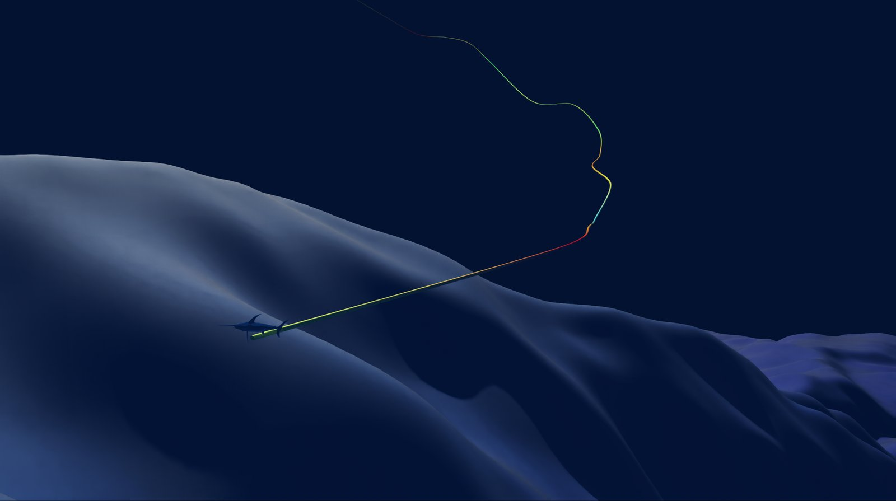
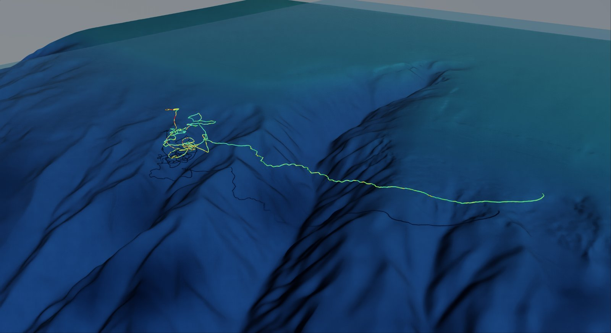

# Biologger Simulation Environment (biologger-sim)

Real-time simulation environment for marine animal tracking and behavioral prediction.

## Overview

This project provides a simulation framework for developing and validating biologger algorithms. It supports a "Dual-Mode" architecture:

1. **Lab Mode**: High-precision, acausal processing for post-hoc analysis.
2. **Simulation Mode**: Real-time, causal processing for on-tag algorithm development.

It integrates with **NVIDIA Omniverse** via ZeroMQ for high-fidelity visualization.



*Swordfish RED001 at the bottom of its deepest dive (610 m), on a canyon ridge with the slope falling away beyond it, in a run stopped at that moment (`--stop-at 28627`); the trail, coloured by ODBA, shows the descent. Showcase settings: 3x vertical exaggeration, the seafloor lit at full strength by the blue light left at that depth (in reality it is close to dark), exposure one stop brighter than the default, a 25 cm trail, and the position uncertainty band hidden. The seafloor is GMRT multibeam at about 60 m resolution, which is why it looks smooth at this range.*



*Swordfish RED001's 9.2 h track over the outer shelf and submarine canyons south of New England, coloured by ODBA, at 3x vertical exaggeration. The dark line on the seafloor is the trail's shadow.*

### Visualization Features

- **Georeferenced tracks**: dead-reckoned tracks are anchored to the deployment's start and end fixes, and the region the animal could have reached is outlined as a position uncertainty band.
- **Real seafloor**: a fused digital elevation model from the `topobathykit` service (GEBCO, GMRT multibeam, NOAA BlueTopo and NCEI BAG surveys at 30 m), cached per fusion policy.
- **Physically based look**: the sun and sky for the deployment's place and date, a refractive sea surface, underwater visibility limits, and seafloor colour seen through the water column, at a fixed exposure.
- **Effort-coloured trail**: a matte tube coloured by overall dynamic body acceleration (ODBA), averaged to the tube's width, whose width follows the camera's distance in overview.
- **Vertical exaggeration**: `V` and `Shift+V` stretch the seafloor, trails and depths together from 1x to 10x.
- **Follow Mode and agent control**: an orbiting follow camera, keyboard and gamepad controls, and HTTP routes for scripted camera moves and captures.

## Installation

### Standard Python (Recommended)

```bash
# Create virtual environment
python3 -m venv .venv
source .venv/bin/activate  # On Windows: .venv\Scripts\activate

# Install package
pip install -e ".[dev]"
```

### via Micromamba (Alternative)

```bash
# Create environment (if not exists)
micromamba env create -f environment.yml
micromamba activate biologger-sim

# Install package
pip install -e .
```

## Usage

### Streaming Data

To stream a CSV file to the visualization client:

```bash
python -m biologger_sim --config config/Swordfish-RED001_20220812_19A0564-postfacto.yaml
```

Add `--speed 120` to replay a post-facto deployment at 120 times real time, and `--stop-at SECONDS` to end the stream that far into the record, so the viewer holds the animal mid-run. `--uncork` streams as fast as the processing allows (about 1,700 times real time for RED001, a 9.2 h record in 20 s); samples are sent in batches, so the viewer receives every one at any speed. Start the Omniverse viewer first; it subscribes to the stream and builds the scene as the metadata arrives.

## Architecture

- **Core**: Type definitions, configuration, georeferencing and track models.
- **IO**: Data streaming (CSV) and ZeroMQ publishing.
- **Processing**: Lab (acausal) and simulation (causal) processors: calibration, attitude estimation and dead reckoning.
- **Viewer**: the Omniverse Kit extension in `omniverse/extensions/whoimpg.biologger.subscriber`.

## Documentation

The Sphinx documentation is in `docs/source/`. For the viewer, start with:

- [User Guide](docs/source/visualization/user_guide.rst): camera modes, replay, configuration.
- [Scene and Look](docs/source/visualization/scene.rst): georeferencing, the seafloor, sun, sky, water, the trail and their settings.
- [Controls Cheat Sheet](docs/source/visualization/controls.rst): every key, mouse and gamepad control, and the agent routes.

Build the site with `sphinx-build docs/source docs/build`.

## License

Apache License 2.0

## Attribution

This simulation environment is built on biologger processing algorithms originally developed in R by Camrin Braun at the Woods Hole Oceanographic Institution Marine Predators Group, and ported to Python by Daniel Fry.

## Troubleshooting

### UJITSO / DomeLight Build Errors

If you encounter errors similar to:

```text
[Error] [gpu.foundation.plugin] Failed to request UJITSO build result for: ./textures/color_0C0C0C.exr:5
[Error] [rtx.scenedb.plugin] Failed to upload DomeLight texture ./textures/color_0C0C0C.exr
```

This indicates a stale build state. Please rebuild the project:

**Windows:**

```bash
.\repo.bat build -c
.\repo.bat build
```

**Linux:**

```bash
./repo.sh build -c
./repo.sh build
```
