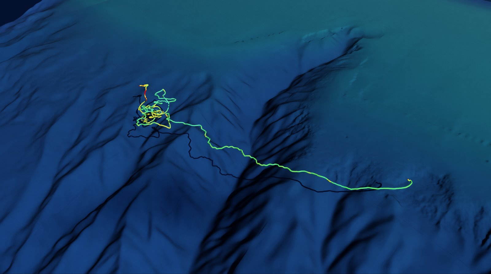
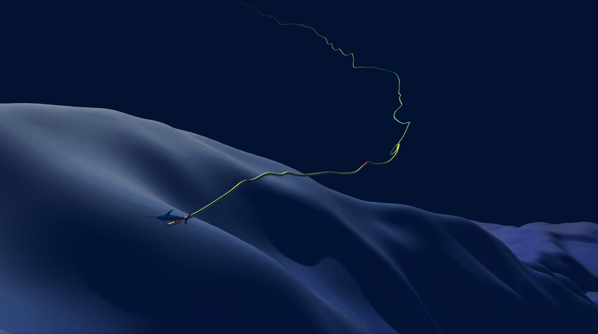

Scene and Look
==============

The viewer places each deployment where it happened: the seafloor, sun, sky and water come
from the deployment's position and date, and the animal swims its reconstructed track over
the real bathymetry. This page explains what each part of the scene shows and the settings
that change it. The keys and routes are in the :doc:`controls`.

*Swordfish RED001's 9.2 h track, coloured by ODBA, at 3x vertical exaggeration. The dark
line on the seafloor is the trail's shadow.*

Georeferencing
--------------

Dead reckoning alone drifts: speed and heading errors accumulate over hours. The simulator
anchors each track to its deployment fixes (``biologger_meta.csv``) with one of three track
models, chosen by ``dead_reckoning.track_model`` in the YAML configuration:

``dead_reckoning``
   The raw dead-reckoned track, starting at the start fix.

``fix_pinned``
   The dead-reckoned track rotated and scaled so it ends exactly on the end fix. The heading
   is rotated by the same angle, so the body still points along its path. The rotation is
   published as ``heading_correction_deg``.

``fix_interpolation``
   Positions interpolated between the fixes. The shape between fixes is lost, and the animal
   can appear to swim sideways.

With a georeference the simulator also publishes the deployment's metadata (origin, fixes
and the space-time prism) on a metadata topic, which the viewer uses for everything below.

Seafloor
--------

The seafloor is a fused digital elevation model (DEM) from the ``topobathykit`` service
(``topobathykitUrl``, default ``garnet.internal:9595``).

*  **Fused grid** (default): the viewer asks the service to fuse the deployment area once,
   with the fusion policy named in the ``demPolicy`` setting (default
   ``config/topobathykit/ne_canyons.yaml``: GEBCO 2025, GMRT multibeam, NOAA BlueTopo and
   NCEI BAG surveys, at 30 m). The result is cached under ``omniverse-logs/dem-cache`` by
   policy, bounds and resolution, so later runs load it in seconds. Bump the policy's
   ``version`` whenever its content changes.
*  **Tiles**: with ``demPolicy`` set to an empty string, the viewer streams the service's
   tiles around the animal instead.

The HUD's **Stream DEM Tiles (georeferenced)** box (the ``demStreaming`` setting) turns the
seafloor on and off for either source.

The seafloor's colour is wet sediment (shelf sand to slope mud) seen through the water
column. With depth it fades into the deep-water colour, using light attenuation for clear
oceanic water (Jerlov type IB) with an exaggerated clarity so the shelf stays readable. A
hillshade lit from the scene's sun is baked into the colour, because the renderer does not
dim light through water.

Position Uncertainty
--------------------

The orange band at the surface outlines the space-time prism: the region where the animal
could have been, given its start and end fixes and a maximum sustained speed for its
species. It is drawn as an outline so the animal and seafloor stay visible inside it. The
HUD's **Show Position Uncertainty** box turns it on and off.

Sun, Sky and Exposure
---------------------

Before a georeference arrives the scene is lit by a neutral sun (45 degrees up, from the
south-east). Once it arrives, the sun stands where it was over the start fix at a chosen
local solar time on the deployment date (default 09:00). The sky dome is a clear-sky model
for that sun position. Direct sun and sky light are balanced for a clear morning (about 3.4
to 1 on level ground), and exposure is fixed (f/11, ACES tone mapping), so brightness
reflects the light rather than the camera adapting.

Water
-----

The sea surface is a thin refractive interface (index 1.333). Below it, distance fog in
the deep-water colour limits visibility (default 40 m), and the surface's reflection is
turned off: the renderer's fog does not dim light reflected from the underside of the
surface, so the reflected seafloor would otherwise show at full brightness. More than 150 m
below the surface (scene depth) the surface is out of any real view, so the water volume is
hidden and the background becomes the deep-water colour; otherwise the far edges of the
volume and the sun's disc, seen through it, would show kilometres down.

In-Situ Seafloor
----------------

The default seafloor colour is the floor seen from the surface, through the whole water
column; down at the floor, from a camera beside the animal, it would be the deep-water colour
everywhere. With ``look/seafloorInSitu`` on, the seafloor is recoloured in place (no tiles are
fetched again) as sediment lit by the light left at its depth: red is gone and green fading by
the canyon floor, so the floor turns blue. That light is shown at full strength; at canyon
depths the real floor is close to dark. Use it for views from inside the canyons, and turn it
off for overviews.

RED001 reaching the bottom of its deepest dive (610 m), in a run stopped at that moment so
the trail ends at the animal: ``POST /agent/time {"deepest": true}`` gives the time (28627 s),
and ``python -m biologger_sim --config ... --stop-at 28627`` ends the stream there. Shown at
3x exaggeration, with the in-situ seafloor, ``look/fNumber`` 8, a 25 cm trail and the
uncertainty band hidden (``POST /agent/layers {"uncertainty": false}``).

Trail
-----

The trail is a matte tube along the track, coloured by overall dynamic body acceleration
(ODBA), a proxy for effort. It is built from every sample received, not from the poses
shown on rendered frames, so a fast replay or a slow frame does not cut corners. Position
and ODBA are averaged over 2 s of record time (``look/trailSmoothingS``; 0 shows every
sample, with the depth sensor's steps and per-sample ODBA), and again over each tube width
of track, so a wide overview trail shows the mean path and mean effort. In Follow Mode the tube is 5 cm
wide; out of it, the width follows the camera's distance (see :doc:`controls`).

Vertical Exaggeration
---------------------

``V`` and ``Shift+V`` stretch the scene vertically about sea level, from 1x to 10x
(``/agent/exaggeration`` allows up to 20x). The seafloor, uncertainty band, trails and the
animals' depths all stretch together, so the animal stays in the same place relative to the
seafloor; the animal models keep their true shape. Slopes and dive angles look steeper than
they are at any factor above 1x.

Settings
--------

Look settings live under ``/exts/whoimpg.biologger.subscriber/look/``. They can be passed on
the Kit command line (``--/exts/whoimpg.biologger.subscriber/look/solarHour=15``) or changed
at run time with ``POST /agent/settings`` followed by ``POST /agent/look``.

.. list-table::
   :header-rows: 1
   :widths: 30 15 55

   * - Setting
     - Default
     - Effect
   * - ``look/solarHour``
     - 9
     - Local solar time on the deployment date that sets the sun position.
   * - ``look/turbidity``
     - 2
     - Haze in the sky model (2 is clear maritime air).
   * - ``look/sunIntensity``
     - 7000
     - Direct sunlight.
   * - ``look/skyIntensity``
     - 300
     - Sky dome light.
   * - ``look/fNumber``
     - 11
     - Fixed exposure; a higher number gives a darker image.
   * - ``look/underwaterVisibilityM``
     - 40
     - Horizontal visibility below the surface, in metres. The renderer's distance fog
       changes little beyond a few hundred metres.
   * - ``look/trailSmoothingS``
     - 2
     - Record seconds the trail's position and ODBA are averaged over (0: every sample).
   * - ``look/seafloorInSitu``
     - false
     - Seafloor colour for a camera down in the canyons (see In-Situ Seafloor).
   * - ``demPolicy``
     - ``config/topobathykit/ne_canyons.yaml``
     - Fusion policy for the seafloor; empty for streamed tiles.
   * - ``topobathykitUrl``
     - ``http://garnet.internal:9595``
     - Elevation service.

The DEM's baked hillshade keeps the sun it was built with; ``POST /agent/look`` changes the
live lighting only.
