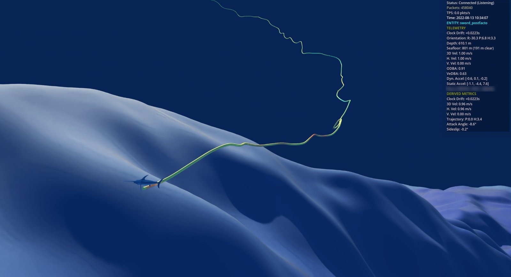

Scene and Look
==============

The viewer places each deployment where it happened. The seafloor, sun, sky and water come
from the deployment's position and date, and the animal swims its reconstructed track over
the real bathymetry. This page explains what each part of the scene shows and which settings
change it. The keys and routes are in the :doc:`controls`.

Georeferencing
--------------

Dead reckoning alone drifts, because speed and heading errors accumulate over hours. The simulator
anchors each track to its deployment fixes (``biologger_meta.csv``) with one of three track
models, chosen by ``dead_reckoning.track_model`` in the YAML configuration:

``dead_reckoning``
   The raw dead-reckoned track, starting at the start fix.

``fix_pinned``
   The dead-reckoned track rotated and scaled so it ends exactly on the end fix. The heading
   is rotated by the same angle, so the body still points along its path. The rotation is
   published as ``heading_correction_deg``.

``fix_interpolation``
   Positions interpolated between the fixes. The shape between fixes is lost, and the animal
   can appear to swim sideways.

With a georeference, the simulator also publishes the deployment's metadata (origin, fixes
and the space-time prism) on a metadata topic. The viewer uses this metadata for everything
below.

Seafloor
--------

The seafloor is a fused digital elevation model (DEM) from the ``topobathykit`` service
(``topobathykitUrl``, default ``http://garnet.internal:9595``).

*  **Fused grid** (default): the viewer asks the service to fuse the deployment area once,
   with the fusion policy named in the ``demPolicy`` setting (default
   ``config/topobathykit/shelf_canyons.yaml``: GEBCO 2025, GMRT multibeam, NOAA BlueTopo and
   NCEI BAG surveys, at 30 m). The result is cached under ``omniverse-logs/dem-cache`` by
   policy, bounds and resolution, so later runs load it in seconds. Increase the policy's
   ``version`` whenever you change the policy's content.
*  **Tiles**: with ``demPolicy`` set to an empty string, the viewer streams the service's
   tiles around the animal instead.

The HUD's **Stream DEM tiles** box (the ``demStreaming`` setting) turns the
seafloor on and off for either source.

The fused grid's color fades into the deep-water color over its outer 3 km. The lower half
of the sky dome is also the deep-water color (``look/belowHorizonGain``), and this half
shows through the sea past the edge of the data. Overviews therefore read as seafloor
running into deep open water, not as a block with hard edges.

The seafloor's color is wet sediment (shelf sand to slope mud) seen through the water
column. With depth, the color fades into the deep-water color. The fade uses light
attenuation for clear oceanic water (Jerlov type IB), with the clarity exaggerated so the
shelf stays readable. A hillshade lit from the scene's sun is baked into the color, because
the renderer does not dim light through water.

With the fused grid loaded, the HUD's **Depth** line gives the depth of the seafloor
directly under the animal and the animal's clearance above it. When the animal is deeper
than the seafloor under its placed position, the line turns orange and reads "BELOW".
The tag's depth is physically impossible at that position, so the horizontal position is
wrong (for example, a dead-reckoned track with a bad heading). With the tile source, the
line shows ``--``, because the tile source does not keep elevations.

Position Uncertainty
--------------------

The orange band at the surface outlines the space-time prism. The prism is the region where
the animal could have been, given its start and end fixes and a maximum sustained speed for
its species. The band is drawn as an outline so the animal and seafloor stay visible inside
it. The HUD's **Position uncertainty band** box turns the band on and off.

Sun, Sky and Exposure
---------------------

Before a georeference arrives, a neutral sun lights the scene (45 degrees up, from the
southeast). Once the georeference arrives, the sun stands where it stood over the start fix
at a chosen local solar time on the deployment date (default 09:00). The sky dome is a
clear-sky model for that sun position. Direct sun and sky light are balanced for a clear
morning (about 3.4 to 1 on level ground). Exposure is fixed (f/11, ACES tone mapping), so
brightness shows the light itself and not a camera adapting to it.

Water
-----

The sea surface is a thin refractive interface (index 1.333). Below the surface, distance
fog in the deep-water color limits visibility (default 40 m), and the surface's reflection
is turned off. The reflection is off because the renderer's fog does not dim light reflected
from the underside of the surface, so the reflected seafloor would otherwise show at full
brightness. More than 150 m below the surface (scene depth), the surface is out of any real
view. There the water volume is hidden and the background becomes the deep-water color.
Otherwise the far edges of the volume, and the sun's disk seen through the volume, would
show kilometers down.

In-Situ Seafloor
----------------

The default seafloor color shows the floor as seen from the surface, through the whole water
column. From a camera beside the animal down at the floor, the same floor would look the
deep-water color everywhere. With ``look/seafloorInSitu`` on, the seafloor is recolored in
place (no tiles are fetched again). The new color is sediment lit by the light that remains
at its depth. By the canyon floor, red light is gone and green is fading, so the floor turns
blue. The viewer shows that light at full strength, although at canyon depths the real floor
is close to dark. Use the in-situ seafloor for views from inside the canyons, and turn it off
for overviews.

RED001 reaching the bottom of its deepest dive (610 m), in a run stopped at that moment so
the trail ends at the animal. ``POST /agent/time {"deepest": true}`` gives the time (28627 s),
and ``python -m biologger_sim --config ... --stop-at 28627`` ends the stream there. The view
uses 3x exaggeration, the in-situ seafloor, ``look/fNumber`` 5.6 and a 25 cm trail, with the
uncertainty band hidden (``POST /agent/layers {"uncertainty": false}``). The HUD is in the
screen-recording layout of ``POST /agent/showcase {"on": true}``. It shows the telemetry at
that moment, including 191 m of clearance above the seafloor. (The screenshot predates the
HUD's current layout, in which telemetry and controls share one column in the viewport's top
left.)

Trail
-----

The trail is a matte tube along the track, colored by overall dynamic body acceleration
(ODBA), a proxy for effort. The trail is built from every sample received, not from the
poses shown on rendered frames, so a fast replay or a slow frame does not cut corners.
Position and ODBA are averaged over 2 s of record time (``look/trailSmoothingS``). A value of
0 shows every sample, with the depth sensor's steps and per-sample ODBA. Position and ODBA
are then averaged again over each tube width of track, so a wide overview trail shows the
mean path and mean effort. In Follow Mode the tube is 5 cm wide. Outside Follow Mode, the
width follows the camera's distance (see :doc:`controls`).

Vertical Exaggeration
---------------------

``V`` and ``Shift+V`` stretch the scene vertically about sea level, from 1x to 10x
(``/agent/exaggeration`` allows up to 20x). The seafloor, uncertainty band, trails and the
animals' depths all stretch together, so the animal stays in the same place relative to the
seafloor. The animal models keep their true shape. At any factor above 1x, slopes and dive
angles look steeper than they are.

Settings
--------

Look settings live under ``/exts/whoimpg.biologger.subscriber/look/``. They can be passed on
the Kit command line (``--/exts/whoimpg.biologger.subscriber/look/solarHour=15``) or changed
at run time with ``POST /agent/settings`` followed by ``POST /agent/look``.

.. list-table::
   :header-rows: 1
   :widths: 30 15 55

   * - Setting
     - Default
     - Effect
   * - ``look/solarHour``
     - 9
     - Local solar time on the deployment date that sets the sun position.
   * - ``look/turbidity``
     - 2
     - Haze in the sky model (2 is clear maritime air).
   * - ``look/sunIntensity``
     - 7000
     - Direct sunlight.
   * - ``look/skyIntensity``
     - 300
     - Sky dome light.
   * - ``look/fNumber``
     - 11
     - Fixed exposure. A higher number gives a darker image.
   * - ``look/underwaterVisibilityM``
     - 40
     - Horizontal visibility below the surface, in meters. The renderer's distance fog
       changes little beyond a few hundred meters.
   * - ``look/belowHorizonGain``
     - 6
     - Brightness of the deep-water color in the sky's lower half, seen past the DEM.
   * - ``look/trailSmoothingS``
     - 2
     - Averaging window for the trail's position and ODBA, in record seconds (0: every
       sample).
   * - ``look/seafloorInSitu``
     - false
     - Seafloor color for a camera down in the canyons (see In-Situ Seafloor).
   * - ``demPolicy``
     - ``config/topobathykit/shelf_canyons.yaml``
     - Fusion policy for the seafloor; empty for streamed tiles.
   * - ``topobathykitUrl``
     - ``http://garnet.internal:9595``
     - Elevation service.

``POST /agent/look`` changes only the live lighting. The DEM's baked hillshade keeps the sun
position used when the DEM was built.
